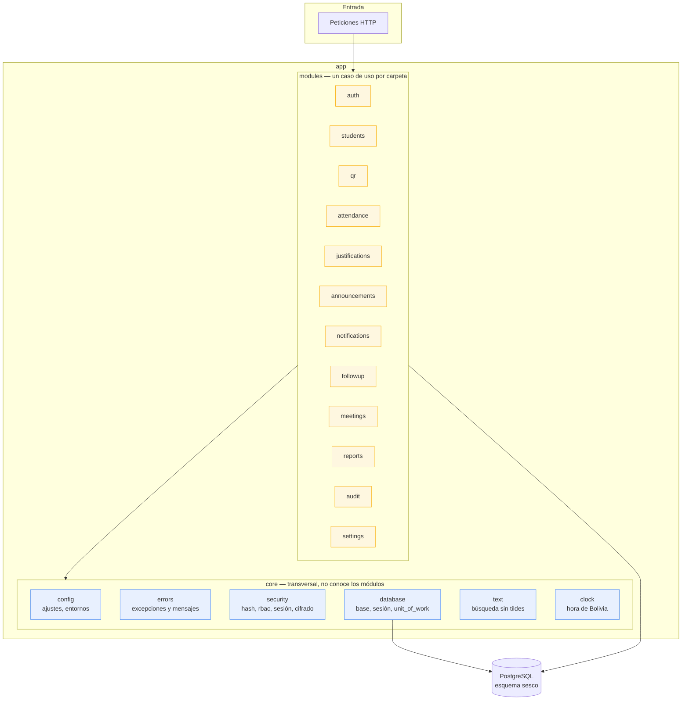
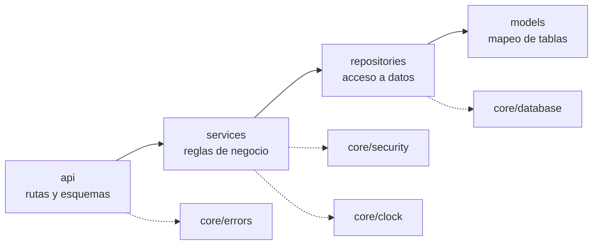

# Arquitectura del backend



## Las cuatro capas de un módulo



- **api**: recibe la petición, valida el cuerpo con Pydantic y devuelve JSON.
  Es la única capa que conoce Flask.
- **services**: decide. No usa Flask ni escribe SQL.
- **repositories**: habla con la base de datos.
- **models**: mapea las tablas.

## Reglas que se verifican automáticamente

```powershell
cd backend
..\venv\Scripts\lint-imports                    # el núcleo no depende de los módulos
..\venv\Scripts\python.exe ..\scripts\verificar_modelos.py   # los modelos coinciden con el esquema
..\venv\Scripts\python.exe -m pytest -q          # las reglas, sin servidor
```

Los contratos de `import-linter` están en `backend/.importlinter` y la
verificación de modelos en `scripts/verificar_modelos.py`. Esta última
compara, tabla por tabla y columna por columna, los modelos SQLAlchemy con el
esquema real de la base de datos.

## Decisión de diseño

La arquitectura y sus alternativas están en
[`docs/adr/0001-arquitectura-por-capas.md`](../adr/0001-arquitectura-por-capas.md).
