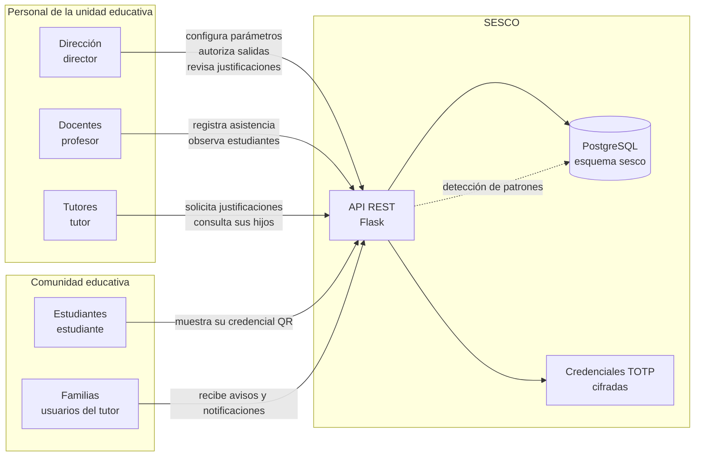

# Diagrama de contexto

## Límites del sistema

- **SESCO** no gestiona la matrícula, la evaluación académica ni la planilla
  docente: solo la asistencia y su seguimiento.
- La **dirección de la unidad educativa** es quien fija los parámetros de
  clasificación (tolerancia y límite de tardanza) y quien autoriza salidas
  anticipadas.
- Los **tutores** ven únicamente a los estudiantes vinculados y confirmados a
  su cargo; el sistema no revela ni siquiera la existencia de los demás.

## Datos de la demostración

Todas las personas, contactos y códigos del conjunto de demostración son
ficticios. Los secretos TOTP de los estudiantes se cifran con la clave
`TOTP_ENCRYPTION_KEY` antes de guardarse, de modo que leer la base de datos no
permite suplantar a ningún estudiante.
