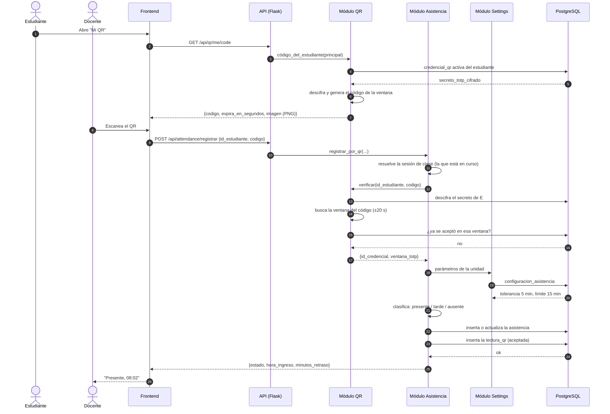

# Flujo de registro de asistencia por QR

## Recorrido de un escaneo

## Decisiones que protege el sistema

| Amenaza | Defensa | Dónde está |
|---|---|---|
| El QR de un estudiante se usa por otro | Cada estudiante tiene su propio secreto TOTP, cifrado en la base | `qr/services/qr_service.py` |
| Se reenvía la foto del QR | El código cambia cada 20 segundos | `qr/services/totp_service.py` |
| Se reutiliza el mismo código | Una lectura aceptada por credencial y ventana, con índice único | tabla `lecturas_qr` |
| Se registra una asistencia sin clase | La sesión se resuelve por el curso del estudiante y la fecha de hoy | `attendance/services/attendance_service.py` |
| Se falsea la hora de ingreso | Todo el tiempo pasa por `clock.now()` (hora de Bolivia) | `core/clock.py` |
| Se ve un estudiante ajeno | La condición de acceso se aplica en la consulta, no después | `students/repositories/students_repository.py` |
| Se pierde el rastro de una operación | Las operaciones sensibles se registran en `bitacora_auditoria` | `audit/services/audit_logger.py` |

## Caminos de error

| Situación | Respuesta | Mensaje |
|---|---|---|
| Código expirado | 422 | "El código QR expiró o no es válido." |
| Código ya usado en esta ventana | 422 | "Ese código QR ya se usó." |
| El QR es de otro estudiante | 422 | "El código QR expiró o no es válido." (no se revela a quién pertenece) |
| No hay clase programada hoy | 404 | "Hoy no hay ninguna clase programada para este estudiante." |
| El estudiante está retirado | 422 | "El estudiante no está activo." |
| Ya había ingreso en esa clase | 200 | "El ingreso ya estaba registrado para esta clase." |

Los rechazos se guardan en `lecturas_qr` con su motivo, para poder auditar
cuántos intentos fallidos hubo y por qué.
